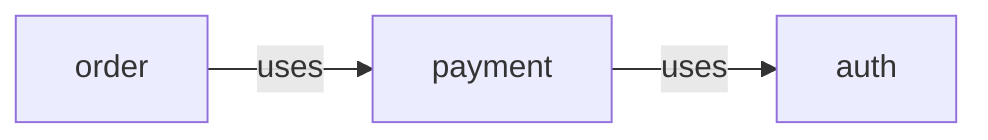

# /sdd-domain

A skill for managing domains.

## Overview

`/sdd-domain` creates, inspects, links, and validates domains in an SDD project, sets dependencies between domains, and renders the dependency graph. Use it to logically group specs in large projects and to model the dependencies between subsystems. The skill runs the matching `sdd domain` CLI command.

## Usage

```
/sdd-domain [create|list|show|link|depends|graph|validate] [args]   # Claude Code
$sdd-domain [create|list|show|link|depends|graph|validate] [args]   # Codex
```

```
/sdd-domain create <name>          # Create domain
/sdd-domain list                   # List domains
/sdd-domain show <name>            # Show details
/sdd-domain link <domain> <spec>   # Link spec
/sdd-domain graph                  # Dependency graph
```

## Subcommands

### create

Create a new domain.

```bash
sdd domain create auth
sdd domain create payment --description "Payment processing"
```

### list

List all domains.

```bash
sdd domain list
sdd domain list --tree      # Tree format
```

### show

Display details for a specific domain (description, linked specs, dependencies).

```bash
sdd domain show auth
```

### link / unlink

Link or unlink specs to a domain.

```bash
sdd domain link auth user-login
sdd domain unlink auth user-login
```

### depends

Set a dependency between two domains (`payment` depends on `auth`).

```bash
sdd domain depends payment --on auth
```

### graph

Visualize the domain dependency graph.

```bash
sdd domain graph              # Mermaid format (default)
sdd domain graph --format dot # DOT format
```

**Example output:**


### validate

Validate the domain structure.

```bash
sdd domain validate
```

Validation checks:
- Circular dependency detection
- Orphaned spec detection
- Schema validity

::: tip CLI-only operations
`sdd domain delete`, `rename`, and `update` exist in the CLI but are not part of the skill's documented subcommands. Run them in a terminal; see [`sdd domain`](/cli/domain).
:::

## Example

```
/sdd-domain create auth --description "User authentication"

AI: $ sdd domain create auth --description "User authentication"
    Domain created: auth

/sdd-domain depends payment --on auth
/sdd-domain graph

AI: graph LR
      payment -->|uses| auth
```

## Next Steps

- After creating a domain: run `/sdd-context set <domain>` to set the active working context
- After linking specs: run `/sdd-domain graph` to verify the structure

## Related Commands

- [`sdd domain`](/cli/domain) - CLI version
- [`/sdd-context`](/commands/sdd-context) - Context setting
- [Domain System Guide](/guide/domains)
