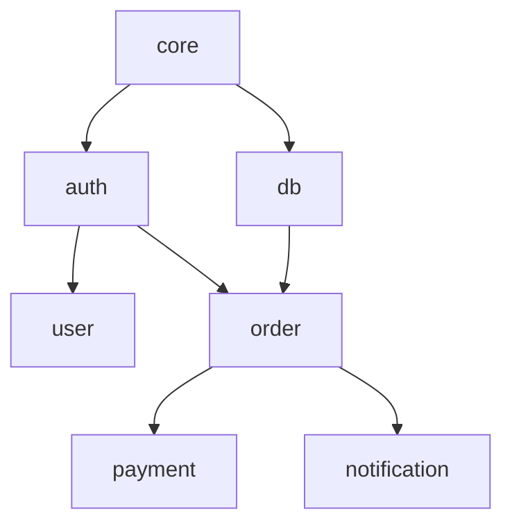

# Large Projects Guide

How to effectively use SDD in large-scale projects.

## Overview

Large-scale projects with hundreds of specs and multiple domains require systematic management. This guide covers domain, context, and dependency management strategies.

## Project Structure

### Recommended Structure

```
.sdd/
├── domains.yml              # Domain definitions
├── .context.json            # Current context
├── specs/                   # <domain>/<feature>/spec.md
│   ├── core/               # Core domain
│   │   ├── data-model/spec.md
│   │   └── validation/spec.md
│   ├── auth/               # Auth domain
│   │   ├── user-login/spec.md
│   │   └── oauth-google/spec.md
│   ├── order/              # Order domain
│   │   ├── create-order/spec.md
│   │   └── payment/spec.md
│   └── ...
└── .reverse-drafts/        # Reverse extraction drafts (temporary)
```

### Domain Hierarchy

```
Core layer (core)
    └── Infrastructure layer (infra, db)
        └── Business layer (auth, user)
            └── Feature layer (order, payment, notification)
```

## Domain Design

### Domain Separation Principles

1. **Single responsibility**: One business area
2. **Low coupling**: Minimize dependencies between domains
3. **High cohesion**: Related specs in same domain

### Domain Size

| Size | Spec Count | Recommended |
|------|------------|-------------|
| Small | 1-2 | Consider merging |
| Optimal | 3-10 | Recommended |
| Large | 10-20 | Consider splitting |
| Oversized | 20+ | Must split |

### Domain Dependencies

```yaml
# domains.yml
domains:
  core:
    description: "Core functionality"
    specs: [data-model, validation, utils]

  auth:
    description: "Authentication"
    dependencies:
      uses: [core]
    specs: [user-login, oauth, session]

  order:
    description: "Orders and payments"
    dependencies:
      uses: [core, auth]
    specs: [create-order, payment, refund]
```

`description` is required for every domain; `specs` and `dependencies` are optional.

## Context Strategy

### During Feature Development

```bash
# Mark the working domain (dependencies are added read-only)
sdd context set auth
sdd context specs   # Specs in scope
sdd new mfa-setup   # → auth/mfa-setup
```

### Cross-Domain Work

```bash
# Load related domains together
sdd context set order payment
sdd new payment/refund   # several active domains: name the domain explicitly
```

### Full Review

```bash
sdd context clear
sdd validate          # validation always covers every spec
sdd validate -d auth  # or one domain
```

The context only sets the default domain of `sdd new` and the scope of `sdd context specs`; it does not filter `sdd list` or `sdd validate`.

## Dependency Management

### Dependency Visualization

```bash
sdd domain graph
```



### Circular Dependency Prevention

```bash
sdd domain validate
```

```
❌ 도메인 검증 실패

📛 에러 (1개):
  • [CIRCULAR_DEPENDENCY] 순환 의존성이 발견되었습니다: order → payment → order (uses)
```

Solution: merge payment into order, or extract the common interface to core. The command exits with code 2 on invalid structure.

### Dependency Rules

```yaml
# domains.yml (top level, next to `domains:`)
rules:
  - from: core
    to: order
    type: uses
    allowed: false
    reason: "core cannot depend on order"
```

`sdd domain validate` reports a `RULE_VIOLATION` when an existing dependency of that type breaks a rule.

## Team Collaboration

### Domain Ownership

```yaml
# domains.yml
domains:
  auth:
    description: "Authentication"
    owner: "@security-team"
    defaults:
      reviewers: ["@lead-dev"]

  payment:
    description: "Payments"
    owner: "@payment-team"
    defaults:
      author: "@payment-team"
      reviewers: ["@finance-lead", "@security-team"]
```

`owner` and `tags` sit directly on the domain; `reviewers` and `author` are only valid inside `defaults`.

### Merge Conflict Prevention

Give every domain its own owner and keep one spec per directory (`.sdd/specs/<domain>/<feature>/`), so
parallel work rarely touches the same files. Use feature branches (`sdd new` creates `feature/<id>` by default)
and [change proposals](/cli/change) for edits to existing specs.

## Performance Optimization

### Scoped Validation

```bash
# Validate specific domain only
sdd validate --domain auth

# Validate a single spec file
sdd validate .sdd/specs/auth/user-login/spec.md
```

## Version Management

### Spec Versions

```yaml
# spec.md frontmatter
version: "1.2.0"
```

Use `status: deprecated` (see `sdd new status <feature> deprecated`) to retire a spec.

## Migration

### Gradual Introduction

```bash
# Step 1: Start with core domain
sdd reverse scan src/core/ --json     # AI reads the code and writes drafts
sdd validate .sdd/.reverse-drafts
sdd reverse review --list
sdd reverse review <ref> --approve
sdd reverse finalize

# Step 2: Dependent domains
sdd reverse scan src/auth/ --json
```

### Legacy Integration

```yaml
# domains.yml
domains:
  legacy:
    description: "Code awaiting migration"
    path: "src/legacy/"
    specs: []
```

## Monitoring

### Progress

```bash
sdd status                 # per-feature status, task progress and next steps
sdd status --domain auth   # one domain
sdd list features --status implementing
```

### Quality Metrics

```bash
sdd quality --all          # per-spec scores and grade distribution
sdd sync                   # spec-to-code traceability
sdd impact report          # dependency health of the whole project
```

## Best Practices Summary

### DO

- Keep domains small and focused
- Clear dependency direction (core → feature)
- Actively use context
- Regular dependency reviews
- Specify domain ownership

### DON'T

- 20+ specs in one domain
- Allow circular dependencies
- Load entire project at once
- Ignore domain boundaries
- Domains without ownership

## Related Documentation

- [Domain System](./domains.md)
- [Context Guide](./context.md)
- [Reverse Extraction Guide](./reverse-extraction.md)
