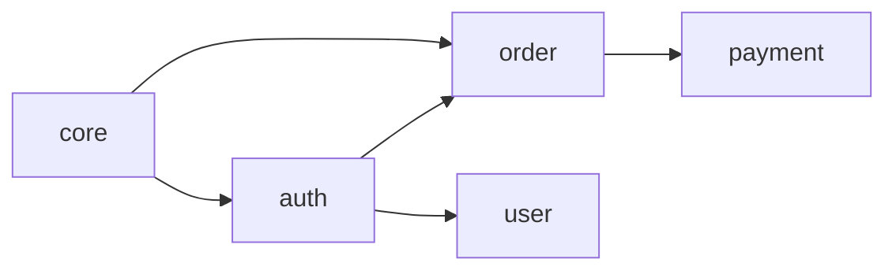

# sdd domain

도메인을 관리하고 의존성 그래프를 시각화합니다.

## 사용법

```bash
sdd domain <command> [options]
```

## 명령어

### create

새 도메인을 생성합니다.

```bash
sdd domain create <name> [options]
```

**옵션:**

| 옵션 | 설명 |
|------|------|
| `-d, --description <text>` | 도메인 설명 |
| `-p, --path <path>` | 소스 코드 경로 |
| `--depends-on <domains...>` | 이 도메인이 사용(uses)하는 도메인 |
| `--extends <domains...>` | 이 도메인이 확장하는 도메인 |
| `--implements <domains...>` | 이 도메인이 구현하는 도메인 |

`owner`, `tags`, `defaults`는 CLI 옵션이 아니므로 `.sdd/domains.yml`에서 설정합니다.
`sdd new <domain>/<feature>`도 없는 도메인을 자동으로 만듭니다(`sdd domain create <domain>`과 동일).

**예시:**

```bash
# 기본 생성
sdd domain create auth

# 상세 옵션
sdd domain create auth \
  --description "인증 및 인가" \
  --path "src/auth" \
  --depends-on core

# 여러 의존성
sdd domain create order --depends-on core auth
```

### list

도메인 목록을 조회합니다.

```bash
sdd domain list [options]
```

**옵션:**

| 옵션 | 설명 |
|------|------|
| `--tree` | 의존성 트리로 표시 |
| `--json` | JSON 형식 출력 |
| `--has-specs` | 스펙이 있는 도메인만 |
| `--orphan` | 스펙이 없는 도메인만 |

**예시:**

```bash
sdd domain list
sdd domain list --tree
sdd domain list --json
```

**출력 예시:**

```
📁 도메인 목록 (5개)

  core       핵심 기능 및 공통 유틸리티     3 스펙
  auth       인증 및 인가                   4 스펙  → core
  user       사용자 관리                    2 스펙  → core, auth
  order      주문 및 결제                   5 스펙  → core, auth
  payment    결제 처리                      3 스펙  → core, order
```

### show

도메인 상세 정보를 표시합니다.

```bash
sdd domain show <name>
```

**출력 예시:**

`경로`와 `의존성`은 설정된 경우에만 표시되고, `의존 그래프`는 도메인이 의존 관계에 속할 때 표시됩니다
(`core ← auth ← order`는 "order가 auth에, auth가 core에 의존"한다는 뜻):

```

# auth 도메인
설명: auth 도메인 (reverse finalize로 등록)
경로: src/auth
의존성: core

스펙 목록 (3):
  - login
  - logout
  - register

의존 그래프:
  core ← auth ← order
```

### link

스펙을 도메인에 연결합니다.

```bash
sdd domain link <domain> <spec>
```

**예시:**

```bash
sdd domain link auth user-login
sdd domain link auth oauth-google oauth-apple
```

### unlink

스펙을 도메인에서 연결 해제합니다.

```bash
sdd domain unlink <domain> <spec>
```

**예시:**

```bash
sdd domain unlink auth legacy-login
```

### depends

도메인 의존성을 관리합니다.

```bash
sdd domain depends <domain> --on <target> [options]
```

**옵션:**

| 옵션 | 설명 |
|------|------|
| `--on <target>` | 의존 대상 도메인 |
| `--type <uses\|extends\|implements>` | 의존성 타입 (기본: `uses`) |
| `--remove` | 의존성 제거 |

**예시:**

```bash
# 의존성 추가
sdd domain depends order --on auth

# 의존성 제거
sdd domain depends order --on legacy --remove
```

### graph

의존성 그래프를 생성합니다.

```bash
sdd domain graph [options]
```

**옵션:**

| 옵션 | 설명 | 기본값 |
|------|------|--------|
| `--format` | 출력 형식 (mermaid, dot, json) | mermaid |
| `--output`, `-o` | 파일로 저장 | - |
| `--direction` | 방향 (TD, LR, BT, RL), Mermaid와 DOT 모두 적용 (`TD` → `rankdir=TB`) | LR |

DOT/Mermaid 출력은 도메인 ID와 설명을 따옴표로 감싸고 이스케이프하므로, 하이픈 ID(`user-profile`)나
`"`가 포함된 설명도 유효한 그래프가 됩니다.

**예시:**

```bash
sdd domain graph
sdd domain graph --format dot
sdd domain graph --output graph.md
sdd domain graph --direction TD
```

**Mermaid 출력:**



### delete

도메인을 삭제합니다.

```bash
sdd domain delete <name> [options]
```

**옵션:**

| 옵션 | 설명 |
|------|------|
| `-f, --force` | 연결된 스펙이 있어도 삭제 (domains.yml의 스펙 연결은 도메인과 함께 제거) |
| `--unlink-specs` | 연결된 스펙이 있어도 삭제하고, 해당 스펙 frontmatter의 `domain` 필드도 제거 |

두 옵션이 모두 없으면 스펙이 연결된 도메인은 삭제되지 않습니다. 스펙 파일 자체는 삭제하지 않습니다.

**예시:**

```bash
sdd domain delete legacy
sdd domain delete legacy --force
sdd domain delete legacy --unlink-specs
```

### rename

도메인 이름을 변경합니다. 스펙 폴더 `.sdd/specs/<old>/`를 `.sdd/specs/<new>/`로 옮기고,
해당 스펙들의 `domain` 필드도 갱신합니다. `.sdd/specs/<new>/`가 이미 있으면 아무것도 바꾸지 않고 실패합니다.

```bash
sdd domain rename <old-name> <new-name>
```

**예시:**

```bash
sdd domain rename auth authentication
```

### update

도메인의 설명이나 소스 경로를 수정합니다.

```bash
sdd domain update <name> [-d, --description <text>] [-p, --path <path>]
```

### validate

도메인 구조(순환 의존성, 의존성 규칙, 없는 도메인)를 검증합니다. 구조가 잘못되면 종료 코드 2
(`VALIDATION_FAILED`)로 끝납니다.

```bash
sdd domain validate
```

## 설정 파일

도메인은 `.sdd/domains.yml`에 저장됩니다:

```yaml
version: "1.0"
domains:
  core:
    description: "핵심 기능"
    path: "src/core"
    specs:
      - data-model
      - validation

  auth:
    description: "인증 및 인가"
    path: "src/auth"
    specs:
      - user-login
      - oauth-google
    dependencies:
      uses: [core]
    owner: "@security-team"
```

## 관련 문서

- [도메인 시스템 가이드](../guide/domains.md)
- [sdd context](./context.md)
- [sdd validate](./validate.md)
