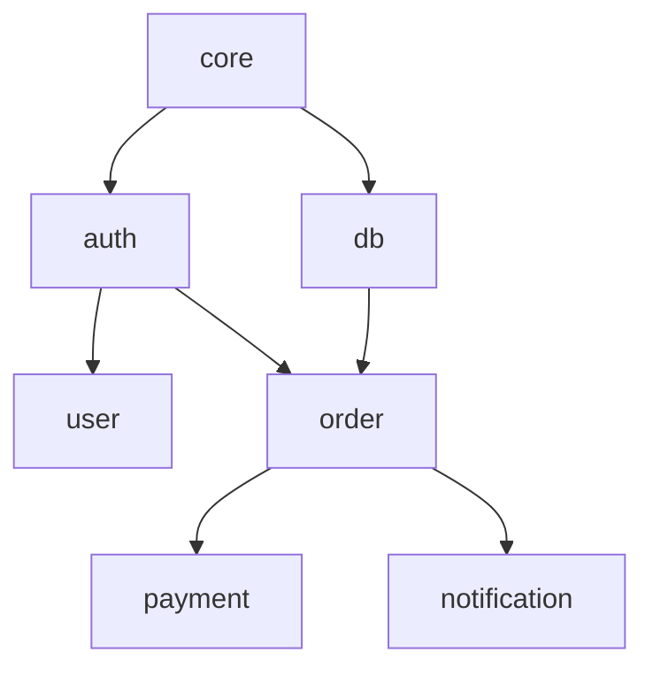

# 대규모 프로젝트 가이드

대규모 프로젝트에서 SDD를 효과적으로 사용하는 방법을 설명합니다.

## 개요

수백 개의 스펙과 여러 도메인이 있는 대규모 프로젝트에서는 체계적인 관리가 필요합니다. 이 가이드에서는 도메인, 컨텍스트, 의존성 관리 전략을 다룹니다.

## 프로젝트 구조

### 권장 구조

```
.sdd/
├── domains.yml              # 도메인 정의
├── .context.json            # 현재 컨텍스트
├── specs/                   # <domain>/<feature>/spec.md
│   ├── core/               # 핵심 도메인
│   │   ├── data-model/spec.md
│   │   └── validation/spec.md
│   ├── auth/               # 인증 도메인
│   │   ├── user-login/spec.md
│   │   └── oauth-google/spec.md
│   ├── order/              # 주문 도메인
│   │   ├── create-order/spec.md
│   │   └── payment/spec.md
│   └── ...
└── .reverse-drafts/        # 역추출 초안 (임시)
```

### 도메인 계층

```
핵심 계층 (core)
    └── 인프라 계층 (infra, db)
        └── 비즈니스 계층 (auth, user)
            └── 기능 계층 (order, payment, notification)
```

## 도메인 설계

### 도메인 분리 원칙

1. **단일 책임**: 하나의 비즈니스 영역
2. **낮은 결합도**: 도메인 간 의존성 최소화
3. **높은 응집도**: 관련 스펙은 같은 도메인

### 도메인 크기

| 크기 | 스펙 수 | 권장 여부 |
|------|---------|----------|
| 작음 | 1-2개 | ⚠️ 병합 고려 |
| 적정 | 3-10개 | ✅ 권장 |
| 큼 | 10-20개 | ⚠️ 분할 고려 |
| 과대 | 20개+ | ❌ 분할 필요 |

### 도메인 의존성

```yaml
# domains.yml
domains:
  core:
    description: "핵심 기능"
    specs: [data-model, validation, utils]

  auth:
    description: "인증"
    dependencies:
      uses: [core]
    specs: [user-login, oauth, session]

  order:
    description: "주문과 결제"
    dependencies:
      uses: [core, auth]
    specs: [create-order, payment, refund]
```

`description`은 모든 도메인에 필수이고 `specs`와 `dependencies`는 선택입니다.

## 컨텍스트 전략

### 기능 개발 시

```bash
# 작업할 도메인 지정 (의존 도메인은 읽기 전용으로 추가)
sdd context set auth
sdd context specs   # 범위 안의 스펙
sdd new mfa-setup   # → auth/mfa-setup
```

### 크로스 도메인 작업

```bash
# 관련 도메인 함께 로드
sdd context set order payment
sdd new payment/refund   # 활성 도메인이 여러 개이면 도메인을 명시
```

### 전체 검토 시

```bash
sdd context clear
sdd validate          # 검증은 항상 모든 스펙을 대상으로 함
sdd validate -d auth  # 또는 한 도메인만
```

컨텍스트는 `sdd new`의 기본 도메인과 `sdd context specs`의 범위만 정하며, `sdd list`나 `sdd validate`를 필터링하지 않습니다.

## 의존성 관리

### 의존성 시각화

```bash
sdd domain graph
```



### 순환 의존성 방지

```bash
sdd domain validate
```

```
❌ 도메인 검증 실패

📛 에러 (1개):
  • [CIRCULAR_DEPENDENCY] 순환 의존성이 발견되었습니다: order → payment → order (uses)
```

해결책: payment를 order에 병합하거나 공통 인터페이스를 core로 추출하세요. 구조가 잘못되면 종료 코드 2로 끝납니다.

### 의존성 규칙

```yaml
# domains.yml (최상위, `domains:`와 같은 레벨)
rules:
  - from: core
    to: order
    type: uses
    allowed: false
    reason: "core는 order에 의존할 수 없습니다"
```

해당 타입의 기존 의존성이 규칙을 어기면 `sdd domain validate`가 `RULE_VIOLATION`을 보고합니다.

## 팀 협업

### 도메인 소유권

```yaml
# domains.yml
domains:
  auth:
    description: "인증"
    owner: "@security-team"
    defaults:
      reviewers: ["@lead-dev"]

  payment:
    description: "결제"
    owner: "@payment-team"
    defaults:
      author: "@payment-team"
      reviewers: ["@finance-lead", "@security-team"]
```

`owner`와 `tags`는 도메인에 직접 두고, `reviewers`와 `author`는 `defaults` 안에서만 유효합니다.

### 병합 충돌 방지

도메인마다 소유자를 두고 스펙을 디렉토리 하나씩(`.sdd/specs/<domain>/<feature>/`) 유지하면 병렬 작업이
같은 파일을 건드릴 일이 줄어듭니다. 기능 브랜치(`sdd new`는 기본으로 `feature/<id>`를 만듭니다)와
[변경 제안](/ko/cli/change)으로 기존 스펙을 수정하세요.

## 성능 최적화

### 범위 지정 검증

```bash
# 특정 도메인만 검증
sdd validate --domain auth

# 스펙 파일 하나만 검증
sdd validate .sdd/specs/auth/user-login/spec.md
```

## 버전 관리

### 스펙 버전

```yaml
# spec.md frontmatter
version: "1.2.0"
```

스펙을 폐기할 때는 `status: deprecated`를 사용합니다 (`sdd new status <feature> deprecated`).

## 마이그레이션

### 점진적 도입

```bash
# 1단계: 핵심 도메인부터
sdd reverse scan src/core/ --json     # AI가 코드를 읽고 초안 작성
sdd validate .sdd/.reverse-drafts
sdd reverse review --list
sdd reverse review <ref> --approve
sdd reverse finalize

# 2단계: 의존 도메인
sdd reverse scan src/auth/ --json
```

### 레거시 통합

```yaml
# domains.yml
domains:
  legacy:
    description: "마이그레이션 대기 코드"
    path: "src/legacy/"
    specs: []
```

## 모니터링

### 진행 상황

```bash
sdd status                 # 기능별 상태, 작업 진행률, 다음 단계
sdd status --domain auth   # 한 도메인만
sdd list features --status implementing
```

### 품질 지표

```bash
sdd quality --all          # 스펙별 점수와 등급 분포
sdd sync                   # 스펙-코드 추적성
sdd impact report          # 프로젝트 전체 의존성 건강도
```

## 모범 사례 요약

### DO ✅

- 도메인을 작고 집중적으로 유지
- 의존성 방향을 명확히 (core → feature)
- 컨텍스트를 적극 활용
- 정기적인 의존성 검토
- 도메인 소유권 명시

### DON'T ❌

- 20개 이상 스펙을 한 도메인에
- 순환 의존성 허용
- 전체 프로젝트를 한 번에 로드
- 도메인 경계 무시
- 소유권 없는 도메인

## 관련 문서

- [도메인 시스템](./domains.md)
- [컨텍스트 가이드](./context.md)
- [역추출 가이드](./reverse-extraction.md)
