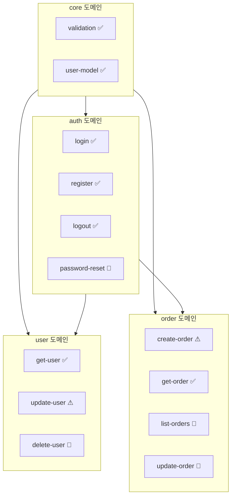

# 브라운필드 프로젝트에 SDD 도입하기

기존 프로젝트에 SDD를 점진적으로 도입하는 튜토리얼입니다.

## 개요

브라운필드(Brownfield) 프로젝트는 이미 코드가 존재하는 프로젝트입니다. 역추출(Reverse Extraction)을 통해 기존 코드에서 스펙을 추출하고, 점진적으로 SDD를 도입할 수 있습니다.

> **Note**: 이 튜토리얼은 Claude Code에서 슬래시 커맨드를 사용하는 대화형 워크플로우를 기반으로 합니다.

## 시나리오

기존 Express API 프로젝트에 SDD를 도입해보겠습니다.

### 현재 구조

```
my-api/
├── src/
│   ├── controllers/
│   │   ├── authController.js
│   │   ├── userController.js
│   │   └── orderController.js
│   ├── services/
│   │   ├── authService.js
│   │   ├── userService.js
│   │   └── orderService.js
│   ├── models/
│   │   ├── User.js
│   │   └── Order.js
│   └── utils/
│       └── validation.js
└── package.json
```

## Step 1: SDD 초기화

먼저 터미널에서 `sdd init` 명령어를 실행합니다:

```bash
cd my-api
sdd init
```

```
✅ SDD 프로젝트가 초기화되었습니다!

생성된 항목:
  📁 .sdd/specs/
  📁 .sdd/changes/
  📁 .sdd/archive/
  📁 .sdd/templates/
  📁 .claude/skills/      ← sdd-* 스킬 30개 (/sdd-*로 호출)
  📁 .agents/skills/      ← Codex용 sdd-* 스킬 30개 ($sdd-*로 호출)
  📁 .claude/agents/, .codex/agents/  ← sdd-* 서브에이전트
  📄 .sdd/constitution.md
  📄 AGENTS.md            ← SDD 지침 블록 (생성 또는 추가, 기존 내용 유지)
  📄 CLAUDE.md            ← @AGENTS.md import (생성 또는 추가)

기존 코드는 그대로 유지됩니다.
다음 단계: Claude Code에서 /sdd-start 를 실행하세요.
```

### Claude Code에서 시작

이제 Claude Code에서 프로젝트를 열고 `/sdd.start`를 실행합니다:

```
/sdd.start
```

Claude가 기존 프로젝트를 분석합니다:

```
📂 프로젝트 상태

✅ SDD 초기화됨
📜 Constitution: 템플릿 (수정 필요)
📋 스펙: 0개

기존 코드베이스 감지:
- 파일: 12개
- 언어: JavaScript

💡 기존 코드에서 스펙을 추출하려면 /sdd.reverse 를 실행하세요.
```

## Step 2: 구조 스캔

역추출은 AI 주도입니다. CLI가 구조를 스캔하고, Claude가 코드를 읽어 스펙 초안을 작성합니다.

```
/sdd.reverse
```

Claude는 먼저 결정적(deterministic) 스캔을 실행합니다:

```bash
sdd reverse scan --json
```

스캔은 파일 수, 소스 파일 수, 실제 라인 수, 언어 분포, 디렉터리 기반 제안 도메인(파일 목록 포함), 어떤 도메인에도 속하지 않는 파일을 보고합니다. 도메인을 생성하지 않으며 메타데이터 파일도 쓰지 않습니다.

이 프로젝트의 출력(요약):

```json
{
  "summary": { "fileCount": 12, "sourceFileCount": 12, "lines": 640, "languages": { "javascript": 12 } },
  "domains": [
    { "id": "controllers", "path": "src/controllers", "fileCount": 3 },
    { "id": "services", "path": "src/services", "fileCount": 3 },
    { "id": "models", "path": "src/models", "fileCount": 2 },
    { "id": "utils", "path": "src/utils", "fileCount": 1 }
  ],
  "unassigned": []
}
```

제안 도메인은 디렉터리 구조를 따르므로 출발점으로만 사용합니다. Claude는 초안을 쓰기 전에 업무 의미 기준으로 다시 묶습니다(여기서는 `core`, `auth`, `user`, `order`). 필요하면 `--include`, `--exclude`, `--language`, `--depth`로 범위를 좁힙니다. 예: `sdd reverse scan src --exclude '*.test.js'`

## Step 3: 초안 작성 (AI)

Claude가 도메인별로 코드를 읽고 기능당 초안 하나를 작성합니다:

```
.sdd/.reverse-drafts/
├── auth/
│   ├── login/spec.md
│   ├── register/spec.md
│   └── logout/spec.md
├── user/
│   └── get-user/spec.md
└── order/
    └── create-order/spec.md
```

초안은 `sdd new`로 만든 스펙과 같은 형식입니다. frontmatter(`id`, `title`, `status: draft`, `created`, `domain`, `depends`), 대문자 RFC 2119 키워드 요구사항, GIVEN/WHEN/THEN 시나리오로 구성됩니다. 초안에는 관찰된 동작만 기록하며, 불확실한 부분은 추측하지 않고 개요에 명시합니다.

초안 예시(요약):

```markdown
---
id: login
title: User Login
status: draft
created: 2026-01-15
domain: auth
depends: null
---

# User Login

> Authenticates a user by email and password.

## Overview

Implemented in `src/controllers/authController.js` and `src/services/authService.js`. The session expiration time could not be determined from the code.

## Requirements

### REQ-01: Token issuance

The system SHALL return a JWT token and the user on valid credentials.

### REQ-02: Password check

The system SHALL respond with 401 (INVALID_PASSWORD) when the password does not match.

## Scenarios

### Scenario 1: Successful login

- **GIVEN** a registered user with a valid email and password
- **WHEN** POST /auth/login is requested
- **THEN** a JWT token and the user info are returned
```

## Step 4: 초안 검증

Claude가 일반 검증기로 초안을 검증하고 오류를 수정합니다:

```bash
sdd validate .sdd/.reverse-drafts
```

보고된 오류는 모두 수정한 뒤 다음 단계로 넘어갑니다.

## Step 5: 초안 검토

Claude가 모든 초안을 리뷰 상태(pending, approved, rejected)와 검증 결과와 함께 나열합니다:

```bash
sdd reverse review --list
```

참조(예: `auth/login`)로 초안 하나를 열어 사용자에게 보여줍니다:

```bash
sdd reverse review auth/login
```

초안을 시스템에 대한 사용자의 지식과 대조해 읽고, 틀린 부분은 Claude에게 수정을 요청합니다. 예:

```
User: 계정 잠금 시나리오 추가해줘. 5회 실패 시 30분 잠금이야.
```

Claude가 `.sdd/.reverse-drafts/auth/login/spec.md`를 수정하고 다시 검증합니다. 리뷰 후 초안을 수정하면 pending으로 초기화되므로, 승인은 항상 현재 내용과 일치합니다.

결정은 사용자가 확인한 뒤에만 기록합니다:

```bash
sdd reverse review auth/login --approve
sdd reverse review user/delete-user --reject --reason "제거 예정인 동작"
```

결정은 `.sdd/.reverse-drafts/review.json`에 저장됩니다. 검증 오류가 있는 초안은 승인할 수 없습니다.

## Step 6: 스펙 확정

```bash
sdd reverse finalize            # 승인된 모든 초안
sdd reverse finalize auth/login # 초안 하나
```

확정하면 승인된 초안이 `.sdd/specs/<도메인>/<기능>/spec.md`로 이동하고, 없는 도메인은 `.sdd/domains.yml`에 등록되며, 스펙이 도메인에 연결되고, 초안은 삭제됩니다:

```
.sdd/specs/
├── auth/
│   ├── login/spec.md
│   ├── register/spec.md
│   └── logout/spec.md
├── user/get-user/spec.md
└── order/create-order/spec.md
```

이미 존재하는 스펙은 덮어쓰지 않으며, 건너뛴 항목이 있으면 0이 아닌 코드로 종료합니다. 덮어쓰려면 `--force`를 사용하세요. 승인되지 않은 초안은 `.sdd/.reverse-drafts/`에 남습니다.

## Step 7: 검증

```
/sdd.validate
```

```
✅ 검증 완료

스펙: 8개
도메인: 4개
의존성: 유효

경고: 2개
  ⚠ login: 출력 타입 User가 core에 정의되지 않음
  ⚠ create-order: 의존성 payment 누락 가능성

오류: 0개
```

### 경고 해결

```
User: User 타입 스펙을 추가하고 경고 해결해줘

Claude: 📝 스펙 추가

user-model 스펙을 생성합니다 (도메인: core):

  ---
  id: user-model
  name: 사용자 모델
  status: approved
  domain: core
  ---

  # 사용자 모델

  interface User {
    id: string;
    email: string;
    name: string;
    createdAt: Date;
    updatedAt: Date;
  }

login의 의존성에 user-model 추가

✅ 경고 해결됨
```

## Step 8: 프로젝트 상태 확인

```
/sdd.status
```

```
📊 프로젝트 현황: my-api

스펙: 9개
  ✅ 구현됨 (레거시): 9개 (100%)
  📋 테스트 추가 필요: 4개
  📝 스펙 보강 필요: 2개

도메인:
  core: 2/2 완료 ████████████ 100%
  auth: 3/3 완료 ████████████ 100%
  user: 2/3 완료 ████████░░░░ 67%
  order: 2/4 완료 ██████░░░░░░ 50%

초안 (미확정): 4개
  → sdd reverse review --list 로 검토 계속

다음 추천 작업:
  1. 남은 초안 검토: sdd reverse review --list
  2. 테스트 추가: "auth/login 테스트 작성해줘"
  3. 새 기능: /sdd.spec
```

## Step 9: 점진적 개선

### 테스트 추가

기존 코드에 테스트를 추가합니다:

```
User: login에 테스트가 없어. 스펙 기반으로 테스트 작성해줘

Claude: 🧪 테스트 생성: login (도메인: auth)

스펙의 시나리오를 기반으로 테스트를 생성합니다:

src/auth/login.test.ts:

  import { describe, it, expect, beforeEach, vi } from 'vitest';
  import { login } from './authService';
  import { User } from '../models/User';

  describe('login', () => {
    beforeEach(() => {
      vi.clearAllMocks();
    });

    it('유효한 자격증명으로 로그인 성공', async () => {
      const result = await login({
        email: 'user@test.com',
        password: 'valid-password'
      });

      expect(result.token).toBeDefined();
      expect(result.refreshToken).toBeDefined();
      expect(result.user.email).toBe('user@test.com');
    });

    it('잘못된 비밀번호로 401 에러', async () => {
      await expect(login({
        email: 'user@test.com',
        password: 'wrong-password'
      })).rejects.toThrow('INVALID_PASSWORD');
    });

    it('존재하지 않는 사용자로 404 에러', async () => {
      await expect(login({
        email: 'unknown@test.com',
        password: 'any-password'
      })).rejects.toThrow('USER_NOT_FOUND');
    });

    it('5회 실패 후 계정 잠금', async () => {
      // 5회 실패 시뮬레이션
      for (let i = 0; i < 5; i++) {
        await expect(login({
          email: 'user@test.com',
          password: 'wrong'
        })).rejects.toThrow();
      }

      await expect(login({
        email: 'user@test.com',
        password: 'correct'
      })).rejects.toThrow('ACCOUNT_LOCKED');
    });
  });

테스트 파일을 생성하시겠습니까? [Y/n]
```

### 새 기능 추가

새 기능은 처음부터 SDD 방식으로 개발합니다:

```
/sdd.spec 비밀번호 재설정
```

```
📝 새 스펙 작성: password-reset (도메인: auth)

기능 설명을 알려주세요:
- 이메일로 재설정 링크 발송
- 링크 클릭 시 새 비밀번호 설정
- 링크 유효 시간은?

User: 이메일로 링크 보내고, 1시간 유효해. 새 비밀번호는 8자 이상이어야 해.

Claude: 📋 스펙 초안

## password-reset (도메인: auth)

### 시나리오

**재설정 요청**
- GIVEN: 등록된 이메일
- WHEN: POST /auth/password-reset/request
- THEN: 재설정 링크가 이메일로 발송됨

**비밀번호 변경**
- GIVEN: 유효한 재설정 토큰, 새 비밀번호 (8자 이상)
- WHEN: POST /auth/password-reset/confirm
- THEN: 비밀번호가 변경됨

**만료된 토큰**
- GIVEN: 1시간 초과된 토큰
- WHEN: POST /auth/password-reset/confirm
- THEN: 400 에러 (TOKEN_EXPIRED)

스펙을 저장하시겠습니까? [Y/n]
```

## Step 10: 지속적인 관리

### 코드와 스펙 동기화 확인

```
/sdd.sync
```

```
🔄 스펙-코드 동기화 검사

✅ 동기화됨: 7개
  - login (도메인: auth)
  - register (도메인: auth)
  - logout (도메인: auth)
  ...

⚠ 불일치: 2개
  - update-user (도메인: user)
    스펙: email 필드 수정 가능
    코드: email 수정 불가 (readonly)
    → 스펙 또는 코드 수정 필요

  - create-order (도메인: order)
    스펙: quantity 필수
    코드: quantity 기본값 1
    → 스펙 업데이트 권장

수정하시겠습니까? [Y/n]
```

### 도메인 그래프

```
/sdd.domain graph
```



## 다음 단계

1. 테스트 추가로 스펙 검증
2. 새 기능은 SDD 방식으로 개발
3. 점진적으로 레거시 코드 리팩토링

## 관련 문서

- [역추출 가이드](/guide/reverse-extraction)
- [도메인 시스템](/guide/domains)
- [대규모 프로젝트](/guide/large-projects)

## 요약

1. `sdd init`으로 프로젝트 초기화 (CLI)
2. `/sdd.start`로 프로젝트 상태 확인 (Claude Code)
3. `sdd reverse scan --json`으로 구조 스캔 (`/sdd.reverse`)
4. AI가 코드를 읽고 `.sdd/.reverse-drafts/`에 초안 작성
5. `sdd validate .sdd/.reverse-drafts`로 초안 검증
6. `sdd reverse review --list`로 검토, 사용자 확인 후 `--approve`로 승인
7. `sdd reverse finalize`로 확정
8. `/sdd.validate`로 검증
9. `/sdd.sync`로 코드-스펙 동기화 관리
10. 점진적으로 테스트 추가 및 개선
