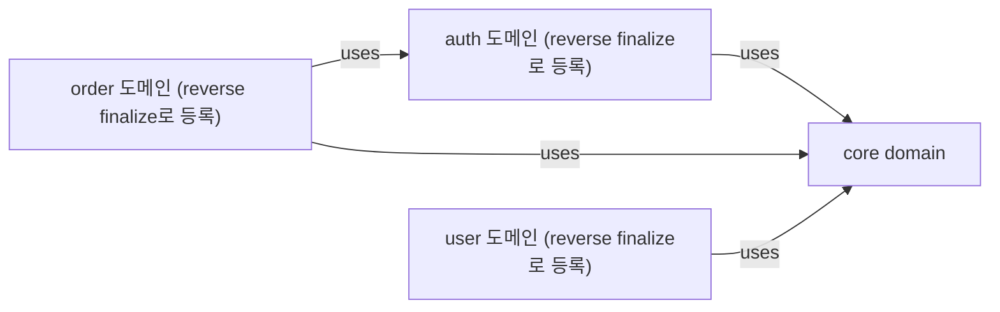

# 브라운필드 프로젝트에 SDD 도입하기

기존 프로젝트에 SDD를 점진적으로 도입하는 튜토리얼입니다.

## 개요

브라운필드(Brownfield) 프로젝트는 이미 코드가 존재하는 프로젝트입니다. 역추출(Reverse Extraction)을 통해 기존 코드에서 스펙을 추출하고, 점진적으로 SDD를 도입할 수 있습니다.

> **Note**: 이 튜토리얼은 Claude Code에서 슬래시 커맨드를 사용하는 대화형 워크플로우를 기반으로 합니다.

## 시나리오

기존 Express API 프로젝트에 SDD를 도입해보겠습니다.

### 현재 구조

```
my-api/
├── src/
│   ├── controllers/
│   │   ├── authController.js
│   │   ├── userController.js
│   │   └── orderController.js
│   ├── services/
│   │   ├── authService.js
│   │   ├── userService.js
│   │   └── orderService.js
│   ├── models/
│   │   ├── User.js
│   │   └── Order.js
│   └── utils/
│       └── validation.js
└── package.json
```

## Step 1: SDD 초기화

먼저 터미널에서 `sdd init` 명령어를 실행합니다:

```bash
cd my-api
sdd init
```

출력(요약):

```
✓ SDD 프로젝트가 초기화되었습니다.

ℹ 생성된 구조:
• .sdd/
  • constitution.md
  • specs/
  • changes/
  • archive/
  • templates/
• .claude/ (Claude Code)
  • skills/ (30개)
  • agents/ (3개)
• .agents/skills/ (Codex 스킬 30개)
• .codex/agents/ (Codex 서브에이전트 3개)
• AGENTS.md (SDD 워크플로우 지침 블록)
• CLAUDE.md (AGENTS.md import)

ℹ 다음 단계:
• constitution.md를 수정하여 프로젝트 원칙을 정의하세요
• /sdd-spec (Codex: $sdd-spec) 으로 첫 번째 기능 명세를 작성하세요
```

기존 코드는 그대로 유지됩니다. 기존 `AGENTS.md` / `CLAUDE.md`가 있으면 내용은 보존되고 SDD 블록만 추가됩니다.

### Claude Code에서 시작

이제 Claude Code(또는 Codex)에서 프로젝트를 열고 `/sdd-start`(`$sdd-start`)를 실행합니다:

```
/sdd-start
```

`/sdd-start`는 먼저 설정 상태(`.sdd/`, Git 저장소와 훅, CI 워크플로우, 기존 `src/`)를 확인합니다. 빠진 항목(훅, CI)이 있으면
선택한 항목에 대해 설정 마법사를 실행하고(`sdd init`, `sdd git hooks install`, `sdd cicd setup github`), 설정이 모두
끝난 뒤에야 다음 스킬을 추천합니다. 새 프로젝트면 `/sdd-spec`, 코드는 있고 스펙이 없는 프로젝트(여기가 해당)면
`/sdd-reverse`입니다.

## Step 2: 구조 스캔

역추출은 AI 주도입니다. CLI가 구조를 스캔하고, Claude가 코드를 읽어 스펙 초안을 작성합니다.

```
/sdd-reverse
```

Claude는 먼저 결정적(deterministic) 스캔을 실행합니다:

```bash
sdd reverse scan --json
```

스캔은 파일 수, 소스 파일 수, 실제 라인 수, 언어 분포, 디렉터리 기반 제안 도메인(파일 목록 포함), 어떤 도메인에도 속하지 않는 파일을 보고합니다. 도메인을 생성하지 않으며 메타데이터 파일도 쓰지 않습니다.

이 프로젝트의 출력(요약. 도메인별 `files` 목록과 `languages`는 생략하고, 파일 수에는 `package.json`과 `sdd init`이 쓴 `AGENTS.md` / `CLAUDE.md`가 포함됩니다):

```json
{
  "summary": { "fileCount": 12, "sourceFileCount": 9, "lines": 18, "languages": { "javascript": 9 } },
  "domains": [
    { "id": "controllers", "path": "src/controllers", "fileCount": 3 },
    { "id": "services", "path": "src/services", "fileCount": 3 },
    { "id": "models", "path": "src/models", "fileCount": 2 }
  ],
  "unassigned": ["src/utils/validation.js"]
}
```

`utils` 같은 범용 폴더는 도메인으로 제안되지 않으므로 `src/utils/validation.js`는 `unassigned`에 남습니다.
제안 도메인은 디렉터리 구조를 따르므로 출발점으로만 사용합니다. Claude는 초안을 쓰기 전에 업무 의미 기준으로 다시 묶습니다(여기서는 `core`, `auth`, `user`, `order`). 필요하면 `--include`, `--exclude`, `--language`, `--depth`로 범위를 좁힙니다. 예: `sdd reverse scan src --exclude '*.test.js'`

## Step 3: 초안 작성 (AI)

Claude가 도메인별로 코드를 읽고 기능당 초안 하나를 작성합니다:

```
.sdd/.reverse-drafts/
├── auth/
│   ├── login/spec.md
│   ├── register/spec.md
│   └── logout/spec.md
├── user/
│   └── get-user/spec.md
└── order/
    └── create-order/spec.md
```

초안은 `sdd new`로 만든 스펙과 같은 형식입니다. frontmatter(`id`, `title`, `status: draft`, `created`, `domain`, `depends`), 대문자 RFC 2119 키워드 요구사항, GIVEN/WHEN/THEN 시나리오로 구성됩니다. 초안에는 관찰된 동작만 기록하며, 불확실한 부분은 추측하지 않고 개요에 명시합니다.

초안 예시(요약):

```markdown
---
id: login
title: User Login
status: draft
created: 2026-01-15
domain: auth
depends: []
---

# User Login

> Authenticates a user by email and password.

## Overview

Implemented in `src/controllers/authController.js` and `src/services/authService.js`. The session expiration time could not be determined from the code.

## Requirements

### REQ-01: Token issuance

The system SHALL return a JWT token and the user on valid credentials.

### REQ-02: Password check

The system SHALL respond with 401 (INVALID_PASSWORD) when the password does not match.

## Scenarios

### Scenario 1: Successful login

- **GIVEN** a registered user with a valid email and password
- **WHEN** POST /auth/login is requested
- **THEN** a JWT token and the user info are returned
```

## Step 4: 초안 검증

Claude가 일반 검증기로 초안을 검증하고 오류를 수정합니다:

```bash
sdd validate .sdd/.reverse-drafts
```

보고된 오류는 모두 수정한 뒤 다음 단계로 넘어갑니다.

## Step 5: 초안 검토

Claude가 모든 초안을 리뷰 상태(pending, approved, rejected)와 검증 결과와 함께 나열합니다:

```bash
sdd reverse review --list
```

참조(예: `auth/login`)로 초안 하나를 열어 사용자에게 보여줍니다:

```bash
sdd reverse review auth/login
```

초안을 시스템에 대한 사용자의 지식과 대조해 읽고, 틀린 부분은 Claude에게 수정을 요청합니다. 예:

```
User: 계정 잠금 시나리오 추가해줘. 5회 실패 시 30분 잠금이야.
```

Claude가 `.sdd/.reverse-drafts/auth/login/spec.md`를 수정하고 다시 검증합니다. 리뷰 후 초안을 수정하면 pending으로 초기화되므로, 승인은 항상 현재 내용과 일치합니다.

결정은 사용자가 확인한 뒤에만 기록합니다:

```bash
sdd reverse review auth/login --approve
sdd reverse review user/delete-user --reject --reason "제거 예정인 동작"
```

결정은 `.sdd/.reverse-drafts/review.json`에 저장됩니다. 검증 오류가 있는 초안은 승인할 수 없습니다.

## Step 6: 스펙 확정

```bash
sdd reverse finalize            # 승인된 모든 초안
sdd reverse finalize auth/login # 초안 하나
```

확정하면 승인된 초안이 `.sdd/specs/<도메인>/<기능>/spec.md`로 이동하고, 없는 도메인은 `.sdd/domains.yml`에 등록되며, 스펙이 도메인에 연결되고, 초안은 삭제됩니다:

```
.sdd/specs/
├── auth/
│   ├── login/spec.md
│   ├── register/spec.md
│   └── logout/spec.md
├── user/get-user/spec.md
└── order/create-order/spec.md
```

이미 존재하는 스펙은 덮어쓰지 않으며, 건너뛴 항목이 있으면 0이 아닌 코드로 종료합니다. 덮어쓰려면 `--force`를 사용하세요. 승인되지 않은 초안은 `.sdd/.reverse-drafts/`에 남습니다.

## Step 7: 검증

```
/sdd-validate
```

`sdd validate`는 형식만 검사합니다(frontmatter, RFC 2119 키워드, GIVEN-WHEN-THEN, 플레이스홀더, constitution 버전).
스펙이 코드와 맞는지는 판단하지 않습니다. 출력(초안에 `constitution_version`이 없으므로 해당 검사는 건너뜁니다):

```
ℹ 검증 중: ./.sdd/specs
ℹ (Constitution 버전 확인 포함)

✓ auth/login/spec.md
✓ auth/logout/spec.md
✓ auth/register/spec.md
✓ order/create-order/spec.md
✓ user/get-user/spec.md

ℹ constitution_version이 없는 스펙 5개는 Constitution 버전 확인을 건너뛰었습니다 (현재 v1.0.0)

결과: 5개 통과, 0개 실패
```

### 공유 스펙 추가와 의존성 선언

코드를 읽다가 Claude는 login과 get-user가 모두 `User`를 반환한다는 것을 발견하고, 새 `core` 도메인에 공유 스펙을
추가합니다(`sdd domain create core`, `sdd domain link core user-model`). 이 스펙은 `sdd validate --strict`를 통과합니다:

```markdown
---
id: user-model
title: "사용자 모델"
status: draft
created: 2026-10-27
domain: core
depends: []
---

# 사용자 모델

> auth와 user 도메인이 공유하는 User 엔티티.

## 요구사항

### REQ-01: 사용자 구조

시스템은 사용자를 `id`, `email`, `name`, `createdAt`, `updatedAt`으로 표현해야 한다(SHALL).

## 시나리오

### Scenario 1: 사용자 생성 (REQ-01)

- **GIVEN** 유효한 이메일과 이름
- **WHEN** 사용자를 생성하면
- **THEN** 사용자에게 id와 두 타임스탬프가 설정된다
```

그런 다음 login의 frontmatter에 의존성을 선언합니다: `depends: [core/user-model]`. `sdd impact`는 `depends`만
의존성으로 인정하며, 본문에서 `core/user-model`을 언급하는 것은 의존성이 아닙니다:

```
$ sdd impact core/user-model
📊 영향도 분석: core/user-model

⚠️  직접 영향 받는 스펙 (이 기능을 사용하는):
  ├─ 🔴 auth/login (explicit)
```

## Step 8: 프로젝트 상태 확인

```
/sdd-status
```

스킬은 `sdd status`를 실행합니다. 확정 직후의 스펙은 아직 `draft`(📝)이므로, 각 기능에 대해 제안되는 다음 단계는
계획 작성입니다:

```
📊 SDD 프로젝트 상태
════════════════════════════════════════

📁 프로젝트 구조:
   ✅ constitution.md
   ✅ AGENTS.md

📋 기능 목록:
   📝 User Login (auth/login)
   📝 User Logout (auth/logout)
   📝 User Registration (auth/register)
   📝 Create Order (order/create-order)
   📝 Get User (user/get-user)

🔀 현재 브랜치: master

💡 다음 단계:
   auth/login: 명세 완성 후 계획 작성 — sdd new plan auth/login (Claude Code /sdd-plan · Codex $sdd-plan)
   auth/logout: 명세 완성 후 계획 작성 — sdd new plan auth/logout (Claude Code /sdd-plan · Codex $sdd-plan)
   ...
```

확정되지 않은 초안은 여기에 표시되지 않으므로 `sdd reverse review --list`로 확인하세요. 이미 존재하는 코드라면 계획과
작업 분해를 건너뛰고 상태를 바로 기록할 수 있습니다(다음 단계).

## Step 9: 점진적 개선

### 확정된 스펙을 구현 완료로 표시

확정된 초안은 `status: draft`로 시작합니다. 코드가 스펙대로 동작함을 확인했다면 기록하세요:

```bash
sdd new status auth/login implemented
```

### 테스트 추가

기존 코드에 테스트를 추가하고, 테스트가 다루는 요구사항을 `@spec auth/login#REQ-01`로 참조합니다:

```
User: login에 테스트가 없어. 스펙 기반으로 테스트 작성해줘

Claude: 🧪 테스트 생성: login (도메인: auth)

스펙의 시나리오를 기반으로 테스트를 생성합니다:

src/auth/login.test.ts:

  import { describe, it, expect, beforeEach, vi } from 'vitest';
  import { login } from './authService';
  import { User } from '../models/User';

  describe('login', () => {
    beforeEach(() => {
      vi.clearAllMocks();
    });

    it('유효한 자격증명으로 로그인 성공', async () => {
      const result = await login({
        email: 'user@test.com',
        password: 'valid-password'
      });

      expect(result.token).toBeDefined();
      expect(result.refreshToken).toBeDefined();
      expect(result.user.email).toBe('user@test.com');
    });

    it('잘못된 비밀번호로 401 에러', async () => {
      await expect(login({
        email: 'user@test.com',
        password: 'wrong-password'
      })).rejects.toThrow('INVALID_PASSWORD');
    });

    it('존재하지 않는 사용자로 404 에러', async () => {
      await expect(login({
        email: 'unknown@test.com',
        password: 'any-password'
      })).rejects.toThrow('USER_NOT_FOUND');
    });

    it('5회 실패 후 계정 잠금', async () => {
      // 5회 실패 시뮬레이션
      for (let i = 0; i < 5; i++) {
        await expect(login({
          email: 'user@test.com',
          password: 'wrong'
        })).rejects.toThrow();
      }

      await expect(login({
        email: 'user@test.com',
        password: 'correct'
      })).rejects.toThrow('ACCOUNT_LOCKED');
    });
  });

테스트 파일을 생성하시겠습니까? [Y/n]
```

### 새 기능 추가

새 기능은 처음부터 SDD 방식으로 개발합니다:

```
/sdd-spec 비밀번호 재설정
```

```
📝 새 스펙 작성: password-reset (도메인: auth)

기능 설명을 알려주세요:
- 이메일로 재설정 링크 발송
- 링크 클릭 시 새 비밀번호 설정
- 링크 유효 시간은?

User: 이메일로 링크 보내고, 1시간 유효해. 새 비밀번호는 8자 이상이어야 해.

Claude: 📋 스펙 초안

## password-reset (도메인: auth)

### REQ-01: 재설정 링크

시스템은 등록된 이메일로 1시간 동안 유효한 재설정 링크를 발송해야 한다(SHALL).

### REQ-02: 비밀번호 변경

시스템은 유효한 재설정 토큰과 새 비밀번호(8자 이상)를 받아들이고 만료된 토큰은 거부해야 한다(SHALL).

### Scenario 1: 재설정 요청 (REQ-01)

- **GIVEN** 등록된 이메일
- **WHEN** POST /auth/password-reset/request
- **THEN** 재설정 링크가 이메일로 발송된다

### Scenario 2: 비밀번호 변경 (REQ-02)

- **GIVEN** 유효한 재설정 토큰과 새 비밀번호 (8자 이상)
- **WHEN** POST /auth/password-reset/confirm
- **THEN** 비밀번호가 변경된다

### Scenario 3: 만료된 토큰 (REQ-02)

- **GIVEN** 1시간 초과된 토큰
- **WHEN** POST /auth/password-reset/confirm
- **THEN** 400 에러(TOKEN_EXPIRED)가 반환된다

스펙을 저장하시겠습니까? [Y/n]
```

## Step 10: 지속적인 관리

### 코드와 스펙 동기화 확인

```
/sdd-sync
```

`sdd sync`는 추적성을 검사합니다. 스펙이 `### REQ-01: 제목` 헤딩으로 정의한 모든 요구사항은 코드나 테스트에서
`@spec <domain>/<feature>#REQ-01`로 참조되어야 합니다. 스킬이 대신 실행해 주며, 터미널에서는 다음과 같이 씁니다:

```bash
sdd sync                          # 리포트만 (종료 코드 0)
sdd sync --ci --threshold 80      # 80% 미만이면 종료 코드 2로 실패
```

```
=== SDD Sync: 스펙-코드 동기화 검증 ===

스펙: 6개, 요구사항: 11개

✓ 구현됨 (3/11)
  - auth/login#REQ-01: Main behavior (test/auth.test.js:1)
  - auth/login#REQ-02: Error handling (src/controllers/authController.js:1)
  - auth/register#REQ-01: Main behavior (src/controllers/authController.js:2)

✗ 미구현 (8/11)
  - auth/logout#REQ-01: Main behavior
  ...

동기화율: 27.27% (3/11)
```

(스펙마다 요구사항이 두 개씩 정의된 프로젝트에서 실제로 실행한 결과이며, 아직 `@spec` 참조가 세 개뿐입니다.)

빠진 `@spec` 참조를 추가하거나, 코드가 맞다면 스펙을 고치세요. 한정하지 않은 `REQ-01`은 그 ID를 가진 스펙이
정확히 하나일 때만 인정되므로 `<domain>/<feature>#`로 스펙을 한정해 참조하세요.

### 도메인 그래프

도메인 의존성을 선언한 뒤(`sdd domain depends auth --on core` 등) 그래프를 출력합니다
(`/sdd-domain graph` 또는 터미널에서 `sdd domain graph`):



## 다음 단계

1. 테스트 추가로 스펙 검증
2. 새 기능은 SDD 방식으로 개발
3. 점진적으로 레거시 코드 리팩토링

## 관련 문서

- [역추출 가이드](/guide/reverse-extraction)
- [도메인 시스템](/guide/domains)
- [대규모 프로젝트](/guide/large-projects)

## 요약

1. `sdd init`으로 프로젝트 초기화 (CLI)
2. `/sdd-start`로 프로젝트 상태 확인 (Claude Code)
3. `sdd reverse scan --json`으로 구조 스캔 (`/sdd-reverse`)
4. AI가 코드를 읽고 `.sdd/.reverse-drafts/`에 초안 작성
5. `sdd validate .sdd/.reverse-drafts`로 초안 검증
6. `sdd reverse review --list`로 검토, 사용자 확인 후 `--approve`로 승인
7. `sdd reverse finalize`로 확정
8. `/sdd-validate`로 검증
9. `/sdd-sync`로 코드-스펙 동기화 관리
10. 점진적으로 테스트 추가 및 개선
