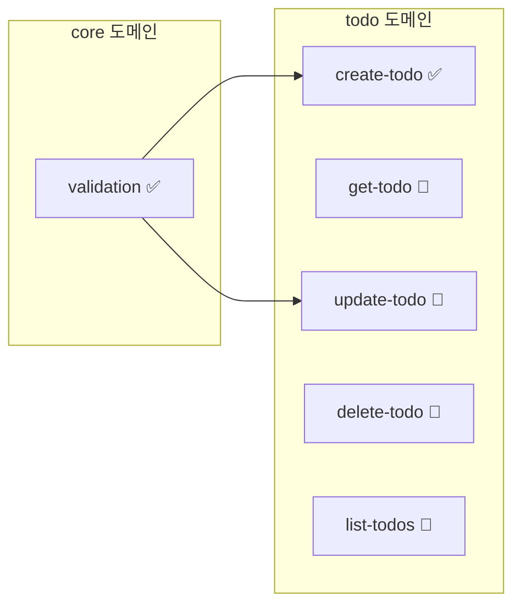

# 그린필드 프로젝트 시작하기

새 프로젝트를 SDD 방식으로 시작하는 튜토리얼입니다.

## 개요

그린필드(Greenfield) 프로젝트는 처음부터 새로 시작하는 프로젝트입니다. SDD를 처음부터 적용하면 명세와 구현이 일치하는 고품질 코드베이스를 만들 수 있습니다.

> **Note**: 이 튜토리얼은 Claude Code에서 슬래시 커맨드를 사용하는 대화형 워크플로우를 기반으로 합니다.

## 시나리오

간단한 할 일 관리 API를 만들어보겠습니다.

## Step 1: 프로젝트 초기화

### 프로젝트 생성

```bash
mkdir todo-api
cd todo-api
npm init -y
```

### SDD 초기화

터미널에서 `sdd init` 명령어를 실행합니다:

```bash
sdd init
```

```
✅ SDD 프로젝트가 초기화되었습니다!

생성된 항목:
  📁 .sdd/specs/
  📁 .sdd/changes/
  📁 .sdd/archive/
  📁 .sdd/templates/
  📁 .claude/skills/      ← sdd-* 스킬 30개 (/sdd-*로 호출)
  📁 .agents/skills/      ← Codex용 sdd-* 스킬 30개 ($sdd-*로 호출)
  📁 .claude/agents/, .codex/agents/  ← sdd-* 서브에이전트
  📄 .sdd/constitution.md
  📄 AGENTS.md            ← SDD 지침 블록
  📄 CLAUDE.md            ← @AGENTS.md import

다음 단계: Claude Code에서 /sdd-start 를 실행하세요.
```

생성되는 구조:

```
todo-api/
├── .sdd/
│   ├── constitution.md     # 프로젝트 원칙
│   ├── specs/              # 스펙 저장소
│   ├── changes/            # 변경 제안
│   ├── archive/            # 아카이브
│   └── templates/          # 템플릿
├── AGENTS.md               # AI 지침 (sdd:begin/end 블록)
├── CLAUDE.md               # @AGENTS.md import
├── .claude/
│   ├── skills/             # sdd-* 스킬 30개
│   └── agents/             # sdd-* 서브에이전트
├── .agents/skills/         # Codex 스킬
├── .codex/agents/          # Codex 서브에이전트
└── package.json
```

### Claude Code에서 시작

이제 Claude Code에서 프로젝트를 열고 `/sdd-start`를 실행합니다:

```
/sdd-start
```

```
📂 프로젝트 상태

✅ SDD 초기화됨
📜 Constitution: 템플릿 (수정 필요)
📋 스펙: 0개

다음 단계: /sdd-constitution 으로 프로젝트 원칙을 정의하세요.
```

## Step 2: 프로젝트 헌법 정의

```
/sdd-constitution
```

Claude가 대화형으로 프로젝트 원칙을 수립합니다:

```
📜 Constitution 설정

프로젝트 이름: todo-api
버전: 1.0.0

핵심 원칙을 정의해주세요:

1. 기술 스택:
   → TypeScript, Express, Prisma

2. 코드 원칙:
   → 함수는 단일 책임 원칙을 따릅니다
   → 에러는 명시적으로 처리합니다
   → 모든 공개 API는 테스트가 필요합니다

3. 네이밍 규칙:
   → 파일명: kebab-case
   → 함수명: camelCase
   → 타입명: PascalCase

Constitution이 저장되었습니다: .sdd/constitution.md
```

## Step 3: 도메인 설계

### 도메인 식별

할 일 API의 주요 도메인을 설계합니다:

```
/sdd-domain
```

Claude와 대화하며 도메인을 설계합니다:

```
User: 할 일 API에 필요한 도메인을 설계해줘

Claude: 📁 도메인 설계

할 일 API에 다음 도메인을 제안합니다:

1. core
   설명: 공통 유틸리티 및 타입
   경로: src/core/

2. todo
   설명: 할 일 CRUD
   경로: src/todo/
   의존성: core

3. user (선택)
   설명: 사용자 관리
   경로: src/user/
   의존성: core

도메인을 생성하시겠습니까? [Y/n]
```

승인하면 도메인이 생성됩니다:

```
✅ 도메인 생성 완료

- core: src/core/
- todo: src/todo/ (depends: core)

domains.yml이 업데이트되었습니다.
```

## Step 4: 첫 번째 스펙 작성

### 새 스펙 생성

```
/sdd-spec 할 일 생성 기능
```

Claude가 대화형으로 스펙을 작성합니다:

```
📝 새 스펙 작성: todo/create-todo

기능 설명을 더 자세히 알려주세요:
- 어떤 데이터가 필요한가요?
- 어떤 검증이 필요한가요?
- 에러 케이스는 무엇인가요?

User: 제목(필수, 1-200자), 설명(선택), 마감일(선택)이 필요해.
      제목이 없거나 200자 초과면 에러야.

Claude: 📋 스펙 초안

## todo/create-todo

새로운 할 일 항목을 생성합니다.

### REQ-01: 할 일 생성

시스템은 제목(1-200자), 선택적 설명, 선택적 마감일로 할 일을 생성해야 한다(SHALL).

### REQ-02: 잘못된 제목 거부

시스템은 제목이 없거나 너무 길면 400 에러로 거부해야 한다(SHALL).

### Scenario 1: 정상 생성 (REQ-01)

- **GIVEN** 유효한 할 일 데이터 (제목: "테스트", 설명: "설명")
- **WHEN** 생성 요청을 보내면
- **THEN** 새 할 일이 생성되고 ID가 반환된다

### Scenario 2: 제목 누락 (REQ-02)

- **GIVEN** 제목이 없는 데이터
- **WHEN** 생성 요청을 보내면
- **THEN** 400 에러(TITLE_REQUIRED)가 반환된다

### Scenario 3: 제목 길이 초과 (REQ-02)

- **GIVEN** 201자 이상 제목
- **WHEN** 생성 요청을 보내면
- **THEN** 400 에러(TITLE_TOO_LONG)가 반환된다

이 스펙은 `core/validation`에 의존합니다 (frontmatter `depends: [core/validation]`).

### 계약

입력:
  interface CreateTodoInput {
    title: string;        // 1-200자, 필수
    description?: string; // 선택
    dueDate?: Date;       // 선택
  }

출력:
  interface Todo {
    id: string;
    title: string;
    description?: string;
    dueDate?: Date;
    completed: boolean;
    createdAt: Date;
  }

스펙을 저장하시겠습니까? [Y/n]
```

저장하면:

```
✅ 스펙 저장 완료

파일: .sdd/specs/todo/create-todo/spec.md
상태: draft
도메인: todo

다음 단계:
- /sdd-spec 으로 추가 스펙 작성
- /sdd-plan 으로 구현 계획 작성
```

## Step 5: 관련 스펙 추가

나머지 스펙도 작성합니다:

```
/sdd-spec 입력 검증 유틸리티
```

```
/sdd-spec 할 일 조회
/sdd-spec 할 일 수정
/sdd-spec 할 일 삭제
/sdd-spec 할 일 목록
```

각 스펙에 대해 Claude와 대화하며 시나리오와 계약을 정의합니다.

## Step 6: 스펙 검증

```
/sdd-validate
```

```
✅ 검증 완료

스펙: 6개
  ✅ validation (도메인: core)
  ✅ create-todo (도메인: todo)
  ✅ get-todo (도메인: todo)
  ✅ update-todo (도메인: todo)
  ✅ delete-todo (도메인: todo)
  ✅ list-todos (도메인: todo)

경고: 0개
오류: 0개

의존성 그래프:
  validation
    └── create-todo
    └── update-todo
```

## Step 7: 구현 계획

```
/sdd-plan create-todo
```

Claude가 구현 계획을 작성합니다:

```
📐 구현 계획: create-todo

## 개요
할 일 생성 기능을 TDD 방식으로 구현합니다.

## 의존성
- validation (먼저 구현 필요)

## 구현 순서

1. 타입 정의
   - CreateTodoInput 인터페이스
   - Todo 인터페이스

2. 검증 로직
   - validateTitle() 함수
   - core/validation 활용

3. 비즈니스 로직
   - createTodo() 함수
   - ID 생성, 타임스탬프 추가

4. API 엔드포인트
   - POST /todos
   - 요청/응답 매핑

## 예상 파일
- src/todo/types.ts
- src/todo/create-todo.ts
- src/todo/create-todo.test.ts
- src/todo/routes.ts

계획을 저장하시겠습니까? [Y/n]
```

## Step 8: 작업 분해

```
/sdd-tasks create-todo
```

```
📋 작업 분해: create-todo (.sdd/specs/todo/create-todo/tasks.md에 기록)

### create-todo-task-001: 타입 정의
- **상태:** 대기
- **우선순위:** 🔴 HIGH
- **설명:** CreateTodoInput, Todo 인터페이스
- **의존성:** 없음

### create-todo-task-002: 실패하는 테스트 작성 (Red)
- **상태:** 대기
- **우선순위:** 🔴 HIGH
- **설명:** 정상 생성, 제목 누락, 제목 길이 초과 (REQ-01, REQ-02)
- **의존성:** create-todo-task-001

### create-todo-task-003: 검증 및 비즈니스 로직 (Green)
- **상태:** 대기
- **우선순위:** 🔴 HIGH
- **설명:** validateTitle(core/validation 연동)과 createTodo
- **의존성:** create-todo-task-002

### create-todo-task-004: 리팩토링 및 API 엔드포인트
- **상태:** 대기
- **우선순위:** 🟡 MEDIUM
- **설명:** 코드 정리와 POST /todos 라우트
- **의존성:** create-todo-task-003
```

각 작업은 `### <feature>-task-NNN: 제목` 헤딩과 `**상태:**` 줄(`대기`, `진행 중`, `완료`, `차단됨`. 영어 `pending`,
`in-progress`, `completed`, `blocked`도 인식)로 이루어집니다. 진행 상황 블록과 frontmatter의 `total:` / `completed:`는
`sdd new task`가 갱신합니다.

## Step 9: 구현

```
/sdd-implement create-todo
```

Claude가 TDD 방식으로 구현을 진행합니다:

```
🔨 구현 시작: create-todo

$ sdd new task todo/create-todo create-todo-task-001 in-progress

## 작업 1/4: 타입 정의

src/todo/types.ts:

  export interface CreateTodoInput {
    title: string;
    description?: string;
    dueDate?: Date;
  }

  export interface Todo {
    id: string;
    title: string;
    description?: string;
    dueDate?: Date;
    completed: boolean;
    createdAt: Date;
  }

✅ 타입 정의 완료

$ sdd new task todo/create-todo create-todo-task-001 completed

## 작업 2/4: 실패하는 테스트 작성

$ sdd new task todo/create-todo create-todo-task-002 in-progress

src/todo/create-todo.test.ts:

  import { describe, it, expect } from 'vitest';
  import { createTodo } from './create-todo';

  // @spec todo/create-todo#REQ-01, todo/create-todo#REQ-02
  describe('createTodo', () => {
    it('유효한 데이터로 할 일을 생성한다', () => {
      const input = { title: '테스트 할 일' };
      const result = createTodo(input);

      expect(result.title).toBe('테스트 할 일');
      expect(result.completed).toBe(false);
      expect(result.id).toBeDefined();
    });

    it('제목이 없으면 에러를 반환한다', () => {
      expect(() => createTodo({ title: '' }))
        .toThrow('TITLE_REQUIRED');
    });

    it('제목이 200자를 초과하면 에러를 반환한다', () => {
      const longTitle = 'a'.repeat(201);
      expect(() => createTodo({ title: longTitle }))
        .toThrow('TITLE_TOO_LONG');
    });
  });

테스트 실행 중... ❌ 3/3 실패 (예상대로)

## 작업 3/4: 구현...
```

모든 작업이 완료되면 터미널에서 스펙을 마무리합니다. `sdd status`는 스펙 상태를 자동으로 바꾸지 않고 이 단계를
제안합니다:

```bash
sdd validate
sdd sync todo/create-todo     # REQ-01, REQ-02가 테스트에서 참조됨: 100%
sdd new status todo/create-todo implemented
# ✅ todo/create-todo 스펙 상태: draft → implemented
```

구현이 완료되면:

```
✅ 구현 완료: create-todo

테스트: ✅ 3/3 통과
파일:
  - src/todo/types.ts
  - src/todo/create-todo.ts
  - src/todo/create-todo.test.ts

스펙 상태: draft → implemented

다음 작업:
- /sdd-implement 으로 다른 스펙 구현
- "다음 뭐 구현할까?" → Claude가 상태와 의존성을 기준으로 추천
```

## Step 10: 반복

남은 스펙도 같은 방식으로 구현합니다:

```
다음 뭐 구현해야 해?
```

Claude가 스펙 상태와 의존성을 확인합니다:

```
📊 다음 구현 추천

의존성 순서 기준:

1. validation ⭐ (의존성 없음)
   - create-todo, update-todo가 의존

2. get-todo (validation 완료 후)
   - 단순 조회, 빠른 구현 가능

3. list-todos (get-todo 완료 후)
   - 페이지네이션 포함

추천: validation 먼저 구현하세요.
"validation 구현해줘" 라고 요청하세요.
```

## 진행 상황 확인

```
/sdd-status
```

```
📊 프로젝트 현황: todo-api

스펙: 6개
  ✅ 구현됨: 2개 (33%)
  🔄 진행중: 1개 (17%)
  📝 초안: 3개 (50%)

도메인:
  core: 1/1 완료 ████████████ 100%
  todo: 1/5 완료 ██░░░░░░░░░░ 20%

테스트: 8/8 통과

다음 단계:
  → "get-todo 구현해줘" 라고 요청하세요
```

## 도메인 그래프 확인

```
/sdd-domain graph
```



## 다음 단계

- [스펙 작성 가이드](/spec-writing/)
- [워크플로우 가이드](/guide/workflow)
- [CI/CD 설정](/guide/cicd-setup)

## 요약

1. `sdd init`으로 프로젝트 초기화 (CLI)
2. `/sdd-start`로 프로젝트 상태 확인 (Claude Code)
3. `/sdd-constitution`으로 원칙 정의
4. `/sdd-domain`으로 도메인 설계
5. `/sdd-spec`으로 스펙 작성
6. `/sdd-validate`로 검증
7. `/sdd-plan`, `/sdd-tasks`로 계획
8. `/sdd-implement`로 TDD 구현
9. `/sdd-status`로 진행 추적
