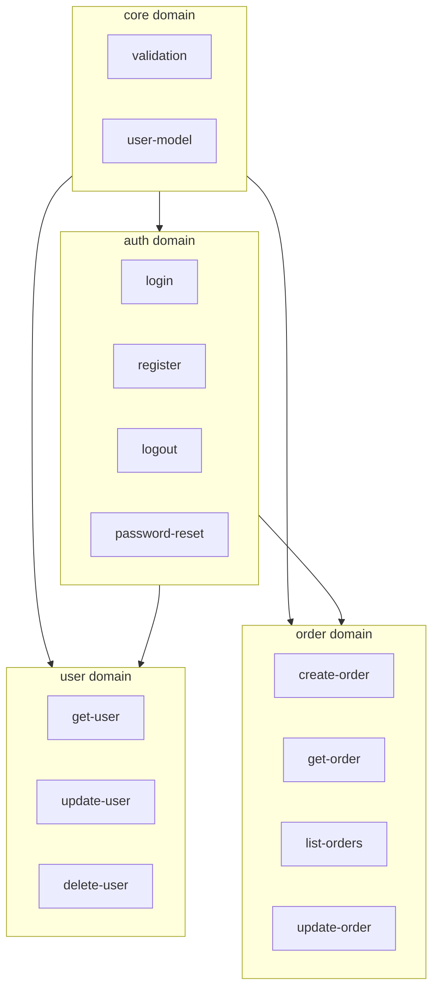

# Introducing SDD to Brownfield Projects

A tutorial for gradually introducing SDD to existing projects.

## Overview

A brownfield project is one with existing code. Through reverse extraction, you can extract specs from existing code and gradually introduce SDD.

> **Note**: This tutorial is based on an interactive workflow using slash commands in Claude Code.

## Scenario

Let's introduce SDD to an existing Express API project.

### Current Structure

```
my-api/
├── src/
│   ├── controllers/
│   │   ├── authController.js
│   │   ├── userController.js
│   │   └── orderController.js
│   ├── services/
│   │   ├── authService.js
│   │   ├── userService.js
│   │   └── orderService.js
│   ├── models/
│   │   ├── User.js
│   │   └── Order.js
│   └── utils/
│       └── validation.js
└── package.json
```

## Step 1: SDD Initialization

First, run the `sdd init` command in your terminal:

```bash
cd my-api
sdd init
```

```
SDD project has been initialized!

Created items:
  .sdd/specs/
  .sdd/changes/
  .sdd/archive/
  .sdd/templates/
  .claude/skills/      <- 30 sdd-* skills (invoked as /sdd-*)
  .sdd/constitution.md
  .sdd/AGENTS.md
  CLAUDE.md            <- Imports @.sdd/AGENTS.md (created or appended)

Existing code remains unchanged.
Next step: Run /sdd-start in Claude Code.
```

### Start in Claude Code

Now open the project in Claude Code and run `/sdd.start`:

```
/sdd.start
```

Claude analyzes the existing project:

```
Project Status

SDD Initialized
Constitution: Template (modification needed)
Specs: 0

Existing codebase detected:
- Files: 12
- Language: JavaScript

Tip: Run /sdd.reverse to extract specs from existing code.
```

## Step 2: Structure Scan

Reverse extraction is AI-driven. The CLI scans the structure; Claude reads the code and writes the spec drafts.

```
/sdd.reverse
```

Claude starts by running the deterministic scan:

```bash
sdd reverse scan --json
```

The scan reports the file count, source file count, real line counts, the language distribution, directory-based suggested domains with their file lists, and files that belong to no domain. It does not create domains and writes no metadata file.

Abbreviated output for this project:

```json
{
  "summary": { "fileCount": 12, "sourceFileCount": 12, "lines": 640, "languages": { "javascript": 12 } },
  "domains": [
    { "id": "controllers", "path": "src/controllers", "fileCount": 3 },
    { "id": "services", "path": "src/services", "fileCount": 3 },
    { "id": "models", "path": "src/models", "fileCount": 2 },
    { "id": "utils", "path": "src/utils", "fileCount": 1 }
  ],
  "unassigned": []
}
```

Suggested domains follow the directory layout, so treat them as a starting point. Claude regroups them by business meaning (here: `core`, `auth`, `user`, `order`) before writing drafts. Narrow the scan with `--include`, `--exclude`, `--language`, or `--depth` when needed, for example `sdd reverse scan src --exclude '*.test.js'`.

## Step 3: Draft Writing (AI)

Claude reads the code of each domain and writes one draft per feature:

```
.sdd/.reverse-drafts/
├── auth/
│   ├── login/spec.md
│   ├── register/spec.md
│   └── logout/spec.md
├── user/
│   └── get-user/spec.md
└── order/
    └── create-order/spec.md
```

Drafts use the same format as specs created with `sdd new`: frontmatter (`id`, `title`, `status: draft`, `created`, `domain`, `depends`), uppercase RFC 2119 requirements, and GIVEN/WHEN/THEN scenarios. Drafts describe observed behavior only. Anything uncertain is noted in the overview, not guessed.

Example draft (abbreviated):

```markdown
---
id: login
title: User Login
status: draft
created: 2026-01-15
domain: auth
depends: null
---

# User Login

> Authenticates a user by email and password.

## Overview

Implemented in `src/controllers/authController.js` and `src/services/authService.js`. The session expiration time could not be determined from the code.

## Requirements

### REQ-01: Token issuance

The system SHALL return a JWT token and the user on valid credentials.

### REQ-02: Password check

The system SHALL respond with 401 (INVALID_PASSWORD) when the password does not match.

## Scenarios

### Scenario 1: Successful login

- **GIVEN** a registered user with a valid email and password
- **WHEN** POST /auth/login is requested
- **THEN** a JWT token and the user info are returned
```

## Step 4: Validate Drafts

Claude validates the drafts with the normal validator and fixes any errors:

```bash
sdd validate .sdd/.reverse-drafts
```

Fix every reported error in the drafts before moving on.

## Step 5: Review Drafts

Claude lists all drafts with their review status (pending, approved, rejected) and validation results:

```bash
sdd reverse review --list
```

Show one draft by its reference (for example `auth/login`) and present it to you:

```bash
sdd reverse review auth/login
```

Read the draft against your knowledge of the system. Ask Claude to correct anything wrong, for example:

```
User: Add an account lockout scenario. Lock for 30 minutes after 5 failures.
```

Claude edits `.sdd/.reverse-drafts/auth/login/spec.md` and re-validates. Editing a draft after review resets it to pending, so approvals always match the current content.

Record your decision only after you confirm:

```bash
sdd reverse review auth/login --approve
sdd reverse review user/delete-user --reject --reason "Behavior is being removed"
```

Decisions are stored in `.sdd/.reverse-drafts/review.json`. Approval is refused for drafts that have validation errors.

## Step 6: Finalize Specs

```bash
sdd reverse finalize            # all approved drafts
sdd reverse finalize auth/login # one draft
```

Finalize moves each approved draft to `.sdd/specs/<domain>/<feature>/spec.md`, registers the domain in `.sdd/domains.yml` if it is missing, links the spec to its domain, and removes the draft:

```
.sdd/specs/
├── auth/
│   ├── login/spec.md
│   ├── register/spec.md
│   └── logout/spec.md
├── user/get-user/spec.md
└── order/create-order/spec.md
```

Finalize refuses to overwrite an existing spec and exits non-zero when it skips something. Pass `--force` to overwrite. Drafts that are not approved stay in `.sdd/.reverse-drafts/`.

## Step 7: Validation

```
/sdd.validate
```

```
Validation complete

Specs: 8
Domains: 4
Dependencies: Valid

Warnings: 2
  - login: Output type User not defined in core
  - create-order: Possible missing dependency on payment

Errors: 0
```

### Resolve Warnings

```
User: Add User type spec and resolve the warning

Claude: Spec added

Creating user-model spec (domain: core):

  ---
  id: user-model
  name: User Model
  status: approved
  domain: core
  ---

  # User Model

  interface User {
    id: string;
    email: string;
    name: string;
    createdAt: Date;
    updatedAt: Date;
  }

Adding user-model to login's dependencies

Warning resolved
```

## Step 8: Check Project Status

```
/sdd.status
```

```
Project Status: my-api

Specs: 9
  Implemented (legacy): 9 (100%)
  Tests needed: 4
  Spec enhancement needed: 2

Domains:
  core: 2/2 complete 100%
  auth: 3/3 complete 100%
  user: 2/3 complete  67%
  order: 2/4 complete  50%

Drafts (unfinalized): 4
  -> Continue review with sdd reverse review --list

Recommended next actions:
  1. Review remaining drafts: sdd reverse review --list
  2. Add tests: "Write tests for auth/login"
  3. New features: /sdd.spec
```

## Step 9: Gradual Improvement

### Add Tests

Add tests to existing code:

```
User: login has no tests. Write tests based on the spec

Claude: Generating tests: login (domain: auth)

Generating tests based on spec scenarios:

src/auth/login.test.ts:

  import { describe, it, expect, beforeEach, vi } from 'vitest';
  import { login } from './authService';
  import { User } from '../models/User';

  describe('login', () => {
    beforeEach(() => {
      vi.clearAllMocks();
    });

    it('successfully logs in with valid credentials', async () => {
      const result = await login({
        email: 'user@test.com',
        password: 'valid-password'
      });

      expect(result.token).toBeDefined();
      expect(result.refreshToken).toBeDefined();
      expect(result.user.email).toBe('user@test.com');
    });

    it('returns 401 with wrong password', async () => {
      await expect(login({
        email: 'user@test.com',
        password: 'wrong-password'
      })).rejects.toThrow('INVALID_PASSWORD');
    });

    it('returns 404 for non-existent user', async () => {
      await expect(login({
        email: 'unknown@test.com',
        password: 'any-password'
      })).rejects.toThrow('USER_NOT_FOUND');
    });

    it('locks account after 5 failures', async () => {
      // Simulate 5 failures
      for (let i = 0; i < 5; i++) {
        await expect(login({
          email: 'user@test.com',
          password: 'wrong'
        })).rejects.toThrow();
      }

      await expect(login({
        email: 'user@test.com',
        password: 'correct'
      })).rejects.toThrow('ACCOUNT_LOCKED');
    });
  });

Create test file? [Y/n]
```

### Add New Features

Develop new features using SDD from the start:

```
/sdd.spec Password reset
```

```
Writing new spec: password-reset (domain: auth)

Tell me about the functionality:
- Send reset link via email
- Set new password when clicking link
- What is the link validity period?

User: Send link via email, valid for 1 hour. New password must be 8+ characters.

Claude: Spec Draft

## password-reset (domain: auth)

### Scenarios

**Reset request**
- GIVEN: Registered email
- WHEN: POST /auth/password-reset/request
- THEN: Reset link sent via email

**Password change**
- GIVEN: Valid reset token, new password (8+ chars)
- WHEN: POST /auth/password-reset/confirm
- THEN: Password changed

**Expired token**
- GIVEN: Token older than 1 hour
- WHEN: POST /auth/password-reset/confirm
- THEN: 400 error (TOKEN_EXPIRED)

Save this spec? [Y/n]
```

## Step 10: Ongoing Management

### Check Code-Spec Synchronization

```
/sdd.sync
```

```
Spec-Code Sync Check

Synchronized: 7
  - login (domain: auth)
  - register (domain: auth)
  - logout (domain: auth)
  ...

Mismatch: 2
  - update-user (domain: user)
    Spec: email field modifiable
    Code: email is readonly
    -> Spec or code modification needed

  - create-order (domain: order)
    Spec: quantity required
    Code: quantity defaults to 1
    -> Spec update recommended

Fix these? [Y/n]
```

### Domain Graph

```
/sdd.domain graph
```



## Next Steps

1. Add tests to verify specs
2. Develop new features using SDD
3. Gradually refactor legacy code

## Related Documentation

- [Reverse Extraction Guide](/guide/reverse-extraction)
- [Domain System](/guide/domains)
- [Large-scale Projects](/guide/large-projects)

## Summary

1. Initialize project with `sdd init` (CLI)
2. Check project status with `/sdd.start` (Claude Code)
3. Scan the structure with `sdd reverse scan --json` (via `/sdd.reverse`)
4. The AI reads the code and writes drafts to `.sdd/.reverse-drafts/`
5. Validate drafts with `sdd validate .sdd/.reverse-drafts`
6. Review with `sdd reverse review --list` and approve with `--approve` after confirming
7. Finalize with `sdd reverse finalize`
8. Validate with `/sdd.validate`
9. Manage code-spec sync with `/sdd.sync`
10. Gradually add tests and improvements
