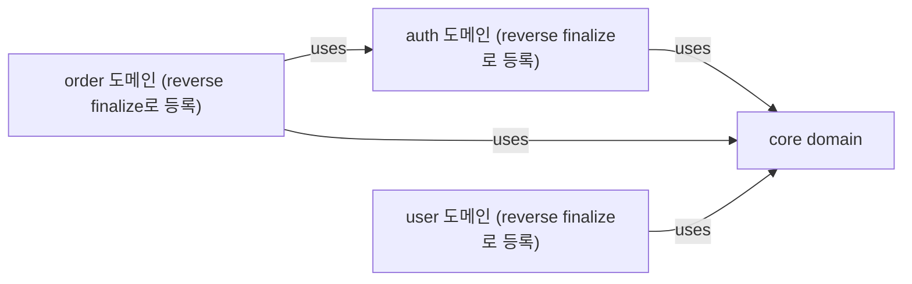

# Introducing SDD to Brownfield Projects

A tutorial for gradually introducing SDD to existing projects.

## Overview

A brownfield project is one with existing code. Through reverse extraction, you can extract specs from existing code and gradually introduce SDD.

> **Note**: This tutorial is based on an interactive workflow using slash commands in Claude Code.

## Scenario

Let's introduce SDD to an existing Express API project.

### Current Structure

```
my-api/
├── src/
│   ├── controllers/
│   │   ├── authController.js
│   │   ├── userController.js
│   │   └── orderController.js
│   ├── services/
│   │   ├── authService.js
│   │   ├── userService.js
│   │   └── orderService.js
│   ├── models/
│   │   ├── User.js
│   │   └── Order.js
│   └── utils/
│       └── validation.js
└── package.json
```

## Step 1: SDD Initialization

First, run the `sdd init` command in your terminal:

```bash
cd my-api
sdd init
```

Output (the CLI prints Korean; abridged):

```
✓ SDD 프로젝트가 초기화되었습니다.

ℹ 생성된 구조:
• .sdd/
  • constitution.md
  • specs/
  • changes/
  • archive/
  • templates/
• .claude/ (Claude Code)
  • skills/ (30개)
  • agents/ (3개)
• .agents/skills/ (Codex 스킬 30개)
• .codex/agents/ (Codex 서브에이전트 3개)
• AGENTS.md (SDD 워크플로우 지침 블록)
• CLAUDE.md (AGENTS.md import)

ℹ 다음 단계:
• constitution.md를 수정하여 프로젝트 원칙을 정의하세요
• /sdd-spec (Codex: $sdd-spec) 으로 첫 번째 기능 명세를 작성하세요
```

Existing code is left unchanged; an existing `AGENTS.md` / `CLAUDE.md` keeps its content (the SDD block is added).

### Start in Claude Code

Now open the project in Claude Code (or Codex) and run `/sdd-start` (`$sdd-start`):

```
/sdd-start
```

`/sdd-start` first checks the setup (`.sdd/`, Git repository and hooks, CI workflow, existing `src/`). If something is
missing (hooks, CI) it runs a setup wizard for the items you pick (`sdd init`, `sdd git hooks install`,
`sdd cicd setup github`). Only after setup is complete does it recommend the next skill: `/sdd-spec` for a new
project, or `/sdd-reverse` for a project with existing code and no specs, as here.

## Step 2: Structure Scan

Reverse extraction is AI-driven. The CLI scans the structure; Claude reads the code and writes the spec drafts.

```
/sdd-reverse
```

Claude starts by running the deterministic scan:

```bash
sdd reverse scan --json
```

The scan reports the file count, source file count, real line counts, the language distribution, directory-based suggested domains with their file lists, and files that belong to no domain. It does not create domains and writes no metadata file.

Abbreviated output for this project (`files` lists and `languages` per domain omitted; the file counts include
`package.json` and the `AGENTS.md` / `CLAUDE.md` written by `sdd init`):

```json
{
  "summary": { "fileCount": 12, "sourceFileCount": 9, "lines": 18, "languages": { "javascript": 9 } },
  "domains": [
    { "id": "controllers", "path": "src/controllers", "fileCount": 3 },
    { "id": "services", "path": "src/services", "fileCount": 3 },
    { "id": "models", "path": "src/models", "fileCount": 2 }
  ],
  "unassigned": ["src/utils/validation.js"]
}
```

Generic folders such as `utils` are never suggested as domains, so `src/utils/validation.js` stays in `unassigned`.
Suggested domains follow the directory layout, so treat them as a starting point. Claude regroups them by business meaning (here: `core`, `auth`, `user`, `order`) before writing drafts. Narrow the scan with `--include`, `--exclude`, `--language`, or `--depth` when needed, for example `sdd reverse scan src --exclude '*.test.js'`.

## Step 3: Draft Writing (AI)

Claude reads the code of each domain and writes one draft per feature:

```
.sdd/.reverse-drafts/
├── auth/
│   ├── login/spec.md
│   ├── register/spec.md
│   └── logout/spec.md
├── user/
│   └── get-user/spec.md
└── order/
    └── create-order/spec.md
```

Drafts use the same format as specs created with `sdd new`: frontmatter (`id`, `title`, `status: draft`, `created`, `domain`, `depends`), uppercase RFC 2119 requirements, and GIVEN/WHEN/THEN scenarios. Drafts describe observed behavior only. Anything uncertain is noted in the overview, not guessed.

Example draft (abbreviated):

```markdown
---
id: login
title: User Login
status: draft
created: 2026-01-15
domain: auth
depends: []
---

# User Login

> Authenticates a user by email and password.

## Overview

Implemented in `src/controllers/authController.js` and `src/services/authService.js`. The session expiration time could not be determined from the code.

## Requirements

### REQ-01: Token issuance

The system SHALL return a JWT token and the user on valid credentials.

### REQ-02: Password check

The system SHALL respond with 401 (INVALID_PASSWORD) when the password does not match.

## Scenarios

### Scenario 1: Successful login

- **GIVEN** a registered user with a valid email and password
- **WHEN** POST /auth/login is requested
- **THEN** a JWT token and the user info are returned
```

## Step 4: Validate Drafts

Claude validates the drafts with the normal validator and fixes any errors:

```bash
sdd validate .sdd/.reverse-drafts
```

Fix every reported error in the drafts before moving on.

## Step 5: Review Drafts

Claude lists all drafts with their review status (pending, approved, rejected) and validation results:

```bash
sdd reverse review --list
```

Show one draft by its reference (for example `auth/login`) and present it to you:

```bash
sdd reverse review auth/login
```

Read the draft against your knowledge of the system. Ask Claude to correct anything wrong, for example:

```
User: Add an account lockout scenario. Lock for 30 minutes after 5 failures.
```

Claude edits `.sdd/.reverse-drafts/auth/login/spec.md` and re-validates. Editing a draft after review resets it to pending, so approvals always match the current content.

Record your decision only after you confirm:

```bash
sdd reverse review auth/login --approve
sdd reverse review user/delete-user --reject --reason "Behavior is being removed"
```

Decisions are stored in `.sdd/.reverse-drafts/review.json`. Approval is refused for drafts that have validation errors.

## Step 6: Finalize Specs

```bash
sdd reverse finalize            # all approved drafts
sdd reverse finalize auth/login # one draft
```

Finalize moves each approved draft to `.sdd/specs/<domain>/<feature>/spec.md`, registers the domain in `.sdd/domains.yml` if it is missing, links the spec to its domain, and removes the draft:

```
.sdd/specs/
├── auth/
│   ├── login/spec.md
│   ├── register/spec.md
│   └── logout/spec.md
├── user/get-user/spec.md
└── order/create-order/spec.md
```

Finalize refuses to overwrite an existing spec and exits non-zero when it skips something. Pass `--force` to overwrite. Drafts that are not approved stay in `.sdd/.reverse-drafts/`.

## Step 7: Validation

```
/sdd-validate
```

`sdd validate` checks format only (frontmatter, RFC 2119 keywords, GIVEN-WHEN-THEN, placeholders, constitution
version). It does not judge whether the spec matches the code. Output (Korean; the drafts were written without
`constitution_version`, so that check is skipped):

```
ℹ 검증 중: ./.sdd/specs
ℹ (Constitution 버전 확인 포함)

✓ auth/login/spec.md
✓ auth/logout/spec.md
✓ auth/register/spec.md
✓ order/create-order/spec.md
✓ user/get-user/spec.md

ℹ constitution_version이 없는 스펙 5개는 Constitution 버전 확인을 건너뛰었습니다 (현재 v1.0.0)

결과: 5개 통과, 0개 실패
```

### Add a Shared Spec and Declare the Dependency

While reading the code, Claude notices that login and get-user both return a `User`. It adds a shared spec in a new
`core` domain (`sdd domain create core`, then `sdd domain link core user-model`). The spec passes
`sdd validate --strict`:

```markdown
---
id: user-model
title: "User Model"
status: draft
created: 2026-10-27
domain: core
depends: []
---

# User Model

> The User entity shared by the auth and user domains.

## Requirements

### REQ-01: User shape

The system SHALL represent a user with `id`, `email`, `name`, `createdAt` and `updatedAt`.

## Scenarios

### Scenario 1: Create a user (REQ-01)

- **GIVEN** a valid email and name
- **WHEN** a user is created
- **THEN** the user has an id and both timestamps set
```

Then declare the dependency in login's frontmatter: `depends: [core/user-model]`. Only `depends` creates a dependency
for `sdd impact`; mentioning `core/user-model` in the body would not:

```
$ sdd impact core/user-model
📊 영향도 분석: core/user-model

⚠️  직접 영향 받는 스펙 (이 기능을 사용하는):
  ├─ 🔴 auth/login (explicit)
```

## Step 8: Check Project Status

```
/sdd-status
```

The skill runs `sdd status`. Right after finalizing, the specs are still `draft` (📝), so the next step it suggests for
each is writing a plan:

```
📊 SDD 프로젝트 상태
════════════════════════════════════════

📁 프로젝트 구조:
   ✅ constitution.md
   ✅ AGENTS.md

📋 기능 목록:
   📝 User Login (auth/login)
   📝 User Logout (auth/logout)
   📝 User Registration (auth/register)
   📝 Create Order (order/create-order)
   📝 Get User (user/get-user)

🔀 현재 브랜치: master

💡 다음 단계:
   auth/login: 명세 완성 후 계획 작성 — sdd new plan auth/login (Claude Code /sdd-plan · Codex $sdd-plan)
   auth/logout: 명세 완성 후 계획 작성 — sdd new plan auth/logout (Claude Code /sdd-plan · Codex $sdd-plan)
   ...
```

Unfinalized drafts are not listed here; use `sdd reverse review --list`. For code that already exists you can skip the plan
and tasks and record the status directly (next step).

## Step 9: Gradual Improvement

### Mark Finalized Specs as Implemented

Finalized drafts start with `status: draft`. Once you have checked that the code really does what a spec says, record it:

```bash
sdd new status auth/login implemented
```

### Add Tests

Add tests to existing code, and reference the requirements they cover as `@spec auth/login#REQ-01`:

```
User: login has no tests. Write tests based on the spec

Claude: Generating tests: login (domain: auth)

Generating tests based on spec scenarios:

src/auth/login.test.ts:

  import { describe, it, expect, beforeEach, vi } from 'vitest';
  import { login } from './authService';
  import { User } from '../models/User';

  describe('login', () => {
    beforeEach(() => {
      vi.clearAllMocks();
    });

    it('successfully logs in with valid credentials', async () => {
      const result = await login({
        email: 'user@test.com',
        password: 'valid-password'
      });

      expect(result.token).toBeDefined();
      expect(result.refreshToken).toBeDefined();
      expect(result.user.email).toBe('user@test.com');
    });

    it('returns 401 with wrong password', async () => {
      await expect(login({
        email: 'user@test.com',
        password: 'wrong-password'
      })).rejects.toThrow('INVALID_PASSWORD');
    });

    it('returns 404 for non-existent user', async () => {
      await expect(login({
        email: 'unknown@test.com',
        password: 'any-password'
      })).rejects.toThrow('USER_NOT_FOUND');
    });

    it('locks account after 5 failures', async () => {
      // Simulate 5 failures
      for (let i = 0; i < 5; i++) {
        await expect(login({
          email: 'user@test.com',
          password: 'wrong'
        })).rejects.toThrow();
      }

      await expect(login({
        email: 'user@test.com',
        password: 'correct'
      })).rejects.toThrow('ACCOUNT_LOCKED');
    });
  });

Create test file? [Y/n]
```

### Add New Features

Develop new features using SDD from the start:

```
/sdd-spec Password reset
```

```
Writing new spec: password-reset (domain: auth)

Tell me about the functionality:
- Send reset link via email
- Set new password when clicking link
- What is the link validity period?

User: Send link via email, valid for 1 hour. New password must be 8+ characters.

Claude: Spec Draft

## password-reset (domain: auth)

### REQ-01: Reset link

The system SHALL email a reset link, valid for 1 hour, to a registered address.

### REQ-02: Password change

The system SHALL accept a new password (8+ chars) with a valid reset token and SHALL reject an expired token.

### Scenario 1: Reset request (REQ-01)

- **GIVEN** a registered email
- **WHEN** POST /auth/password-reset/request
- **THEN** a reset link is sent via email

### Scenario 2: Password change (REQ-02)

- **GIVEN** a valid reset token and a new password (8+ chars)
- **WHEN** POST /auth/password-reset/confirm
- **THEN** the password is changed

### Scenario 3: Expired token (REQ-02)

- **GIVEN** a token older than 1 hour
- **WHEN** POST /auth/password-reset/confirm
- **THEN** a 400 error (TOKEN_EXPIRED) is returned

Save this spec? [Y/n]
```

## Step 10: Ongoing Management

### Check Code-Spec Synchronization

```
/sdd-sync
```

`sdd sync` checks traceability: every requirement a spec defines with a `### REQ-01: Title` heading should be
referenced from code or a test as `@spec <domain>/<feature>#REQ-01`. The skill runs it for you; from a terminal:

```bash
sdd sync                          # report only (exit code 0)
sdd sync --ci --threshold 80      # fail with exit code 2 below 80%
```

```
=== SDD Sync: 스펙-코드 동기화 검증 ===

스펙: 6개, 요구사항: 11개

✓ 구현됨 (3/11)
  - auth/login#REQ-01: Main behavior (test/auth.test.js:1)
  - auth/login#REQ-02: Error handling (src/controllers/authController.js:1)
  - auth/register#REQ-01: Main behavior (src/controllers/authController.js:2)

✗ 미구현 (8/11)
  - auth/logout#REQ-01: Main behavior
  ...

동기화율: 27.27% (3/11)
```

(A real run on a project whose specs define two requirements each; here only three `@spec` references exist so far.)

Add the missing `@spec` references, or fix the spec when the code is right. A bare `REQ-01` is only
counted when exactly one spec has that id, so qualify references with `<domain>/<feature>#`.

### Domain Graph

Declare the domain dependencies (`sdd domain depends auth --on core`, and so on), then print the graph
(`/sdd-domain graph`, or `sdd domain graph` in a terminal):



## Next Steps

1. Add tests to verify specs
2. Develop new features using SDD
3. Gradually refactor legacy code

## Related Documentation

- [Reverse Extraction Guide](/guide/reverse-extraction)
- [Domain System](/guide/domains)
- [Large-scale Projects](/guide/large-projects)

## Summary

1. Initialize project with `sdd init` (CLI)
2. Check project status with `/sdd-start` (Claude Code)
3. Scan the structure with `sdd reverse scan --json` (via `/sdd-reverse`)
4. The AI reads the code and writes drafts to `.sdd/.reverse-drafts/`
5. Validate drafts with `sdd validate .sdd/.reverse-drafts`
6. Review with `sdd reverse review --list` and approve with `--approve` after confirming
7. Finalize with `sdd reverse finalize`
8. Validate with `/sdd-validate`
9. Manage code-spec sync with `/sdd-sync`
10. Gradually add tests and improvements
